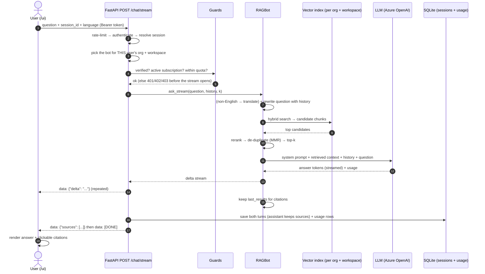
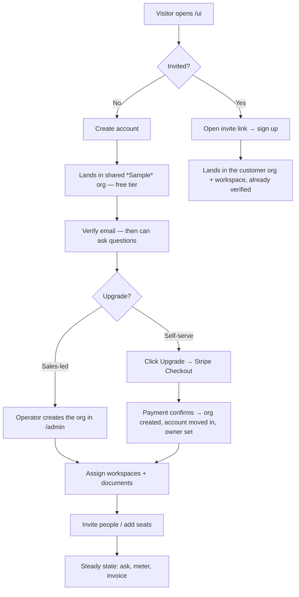

# Platform Workflows

Two end-to-end stories for anyone trying the platform for the first time:

1. **Workflow A — From a user's question to an answer** (what happens inside the box).
2. **Workflow B — The organisation lifecycle** from a fresh signup to a working
   paid organisation (the recommended way to drive every feature through `/admin`,
   `/owner` and `/ui`).

Everything below describes the shipped behaviour. Endpoint names are given so a
technical reader can follow the exact call paths.

---

## 0. The three surfaces

One backend, three web consoles. Each audience gets its own front door over the
same organisation → workspace → users → documents → billing model.

| Surface | URL | Who uses it | Sign-in | What it does |
|---|---|---|---|---|
| **Chat app** | `/ui` | End users (a customer's employees) | Email + password, or a verified invite | Ask questions, see cited answers, browse sessions, upgrade, manage subscription |
| **Owner console** | `/owner` | The customer's organisation owner/admin | Same account, needs an `owner`/`admin` org role | Overview, analytics, people & seats, invites, billing |
| **Admin console** | `/admin` | Platform operator (you) | API key / basic auth / TOTP (`/admin/login`) | Organisations, master library, document assignment, workspaces, users, invites, verifications, usage & cost |

All three are HTML served by the API (`GET /ui`, `/owner`, `/admin`). The chat app
and owner console authenticate a *user account*; the admin console authenticates
the *operator*.

---

## 1. The model in one picture

```
Organisation  (the tenant — owns the plan, the seats and the bill)
│   examples: "Acme Ltd", the shared "Sample" free tier
│
├── Workspaces  (a category of content, e.g. Finance, HR, Climate)
│   │   each workspace owns its OWN document store + vector index
│   │
│   ├── Users    (members holding a seat in the workspace)
│   │
│   └── Documents
│       Master library copy  ──assign──▶  this org's served copy (indexed)
│
└── Billing  (Stripe subscription: plan, seats, question pool, token ceiling)
```

Key ideas that make the rest make sense:

- **An organisation is the unit of billing and isolation.** Two customers both
  holding a "Finance" workspace never share an index: each has its own served copy
  (`data/organisations/<org>/…`) and its own vector store.
- **The master library serves nobody.** The operator curates documents there;
  nothing is searchable until it is *assigned* to an organisation, which copies it
  into that org's workspace and indexes it. **Assignment is the access control.**
- **Customers never upload content.** They buy seats and use what the operator has
  assigned. Only the admin console puts documents into the system.
- **Reachability is computed live.** A member sees exactly the workspaces they hold
  a seat in; an org owner/admin additionally sees every workspace in their org, so
  a grant takes effect without re-issuing a token.

---

## 2. Workflow A — From a user's question to an answer

The browser always streams, so the user sees words appear as the model produces
them. The answer is drawn **only** from documents the user is allowed to see.



**Step by step**

1. **Submit.** The composer sends `POST /chat/stream` with
   `{question, session_id, language}` and the user's token. (A non-streaming
   `POST /chat` exists for API clients and returns the full answer at once.)
2. **Resolve identity and scope.** The request is rate-limited, the token verified,
   and the session validated (or created). The server then selects the bot matching
   **this user's organisation and primary workspace** — the point that guarantees
   one customer can never reach another's documents.
3. **Run the gates, before any model cost is incurred.**

   | Check | Condition | Response |
   |---|---|---|
   | Authentication | Bad/missing token | `401` |
   | Email verification | Free-tier account, email not confirmed | `403` (verify notice) |
   | Subscription state | Org cancelled or unpaid | `402` (billing notice) |
   | Free question count | Sample org past `FREE_TIER_QUESTION_CAP` | `402` (upgrade prompt) |
   | Token ceiling | Paid org past its plan's token cap for the period | `402` (upgrade prompt) |

   Failures return a clean status code the composer renders as a notice or an
   upgrade prompt — the stream is never opened for a blocked request.
4. **Retrieve.** The bot (a) translates a non-English question to English for the
   *search only*, (b) rewrites the question using recent chat history so follow-ups
   make sense, (c) embeds it and runs a hybrid search over **this org's** index,
   (d) reranks and de-duplicates down to the best few chunks.
5. **Answer.** A system prompt (scoped to the workspace topic), the retrieved
   chunks, the recent history and the question go to the LLM; the reply streams
   token-by-token to the browser. If the workspace has no documents at all, the bot
   says so rather than inventing an answer.
6. **Cite.** Each retrieved chunk becomes a citation: the source file plus a signed
   download link (and page range where known). Links are minted server-side, scoped
   to the requesting user, so a shared citation can't be repurposed for another
   customer.
7. **Persist.** Both turns are saved (the assistant turn keeps its citations), token
   usage is recorded for the Usage & Cost tab, and — for a paid org — the question
   is reported against the subscription's question pool.

**Nice touches to point out in a demo**

- Answers are strictly grounded: with no matching content the assistant says it
  can't help instead of guessing.
- Small talk is recognised and answered without touching the model or the quota.
- Follow-ups work because the retrieval query is rewritten from history.
- Non-English questions are answered in the user's language.
- A lapsed subscription blocks the composer with a clear path to renew, rather than
  failing mid-answer.

---

## 3. Workflow B — The organisation lifecycle

This is the recommended operating flow: the shortest path that exercises every
feature and ends with a real customer paying for seats and content. The **free
sample tier** and the **paid organisation** are two ends of the same lifecycle.



### Phase 1 — A user appears

Ways an account comes into existence (all end in the same kind of account):

- **Self-service signup** (`POST /auth/signup`): lands in the shared **Sample** org
  on the free tier, unverified until the email link is opened. Bounded by
  `MAX_FREE_ACCOUNTS`.
- **Invited**: the link carries the destination **organisation + workspace**, so the
  account joins the right org, already verified.
- **Added by an owner** (`/owner` → People): a customer manager creates a seat.
- **Added by the operator** (`/admin` → Users): into any org, or into the free tier.

The **first account placed in a customer org becomes its owner**; later accounts are
members (or admins the owner promotes).

### Phase 2 — The organisation exists

- **Self-serve**: a free user clicks **Upgrade** → Stripe Checkout. Only when
  payment confirms does the platform create the org, move the account into it,
  preserve its workspaces, and set ownership. An abandoned checkout leaves the free
  account untouched.
- **Sales-led**: the operator creates the org in `/admin` → **Organisations** (empty
  at first, ownership granted to the first user added).

The organisation is the unit of isolation and billing from here on.

### Phase 3 — Workspaces

A workspace is a topic category (Finance, HR, or a custom one you create). It owns
its documents and counts its seats.

- The user's **first workspace** is the category chosen at signup.
- **Create a category**: `/admin` → **Content** → *Create workspace*; it becomes
  selectable everywhere immediately.
- An org **gains** a workspace either *by content* (assign a document to it) or *by
  seat* (add a member to it). The org's set of workspaces is the live union of the
  two.

### Phase 4 — People and seats

- **Owner console** (customer-facing): add people, change org role, grant extra
  workspaces, reset a password, suspend, remove. Invites are a one-time link
  (`/ui?invite=<token>`) shown once.
- **Admin console** (operator-facing): create a user into any org, move a free
  account into a customer org, transfer ownership.
- Every membership change updates the **seat count** reported to Stripe, so the next
  invoice reflects reality.

### Phase 5 — Documents

Only the admin console supplies content:

1. **Upload to the master library** (`/admin` → Content → Upload). Curated, but not
   yet searchable by anyone.
2. **Assign** the master document to an organisation + workspace. The platform
   copies it into that org's workspace, records the assignment (the access-control
   record), and **re-indexes the org's own index**.
3. **Upload straight into a workspace** — the *"Upload to this workspace"* shortcut
   uploads and assigns in one step, for a single org.
4. **Shared documents** — one file linked into several workspaces without
   duplicating storage.

The free **Sample** org is deliberately not assignable; free users get the seeded
launch pack. Customers cannot upload at all.

### Phase 6 — Billing and steady state

- **Checkout**: from `/owner` → Billing (or the in-app Upgrade), Stripe handles
  payment. Test mode is enough to walk the whole flow.
- **Mirror**: Stripe events (or the Checkout return sync fallback) write the plan,
  status and billing period onto the org, and snapshot the seat count at each
  renewal. A missed webhook never costs a customer their purchase.
- **Meter**: questions count against the plan's question pool; tokens against the
  plan's token ceiling. Both are visible to the operator in `/admin` → **Usage &
  Cost** and to the customer in `/owner` → Billing.
- **Steady state**: users ask questions (Workflow A), usage accrues, and Stripe
  invoices the plan plus any overage.

---

## 4. Plans and limits (for reference)

| Plan | Included seats | Question pool / period | Token ceiling / period |
|---|---|---|---|
| Free (shared Sample org) | pooled across free users | `FREE_TIER_QUESTION_CAP` per account | 50,000 per account |
| Team | 5 | 500 | 5,000,000 |
| Business | 15 | 2,000 | 20,000,000 |
| Enterprise | unlimited (agreed) | unlimited (agreed) | unmetered |

---

## 5. The "perfect way" to demo this to a client

One golden path that shows everything end to end:

1. **As the visitor** — open `/ui`, create a free account, verify the email, and ask
   a question about the seeded launch pack. Point out the cited sources.
2. **As the operator** — in `/admin`, create an organisation (e.g. *Acme Ltd*), then
   in **Content** upload a document to the master library and assign it to Acme's
   *Finance* workspace. Note it is not visible to the free user.
3. **Invite people** — mint an invite for Acme's *Finance* workspace and open it in
   a fresh browser. The new user lands **inside Acme's Finance workspace**, already
   verified.
4. **Ask again** — the new user gets answers grounded only in Acme's assigned
   documents, and cannot see the free tier's content or any other workspace.
5. **Monetise** — upgrade the free account with Stripe Checkout (test mode), return
   to the app, and show the plan badge and raised quotas. In `/owner` → Billing show
   seats and the question pool; in `/admin` → Usage & Cost show metered questions
   and tokens.
6. **Close the loop** — the Stripe webhook (or the sync fallback) is what keeps the
   org's plan current without anyone touching the database.

---

## 6. Quick endpoint reference

**Chat app (`/ui`)**
- `POST /auth/signup`, `POST /auth/login`, `POST /auth/verify-email`, `POST /auth/forgot-password`, `POST /auth/reset-password`
- `POST /chat` (one shot), `POST /chat/stream` (streamed, used by the UI)
- `GET /invites/{token}` — inspect an invite before signing up
- `POST /billing/upgrade`, `POST /billing/sync`, `GET /billing/usage`

**Owner console (`/owner`)**
- `GET /me`, `GET /org/overview`, `GET /org/usage`
- `GET/POST /org/members`, `POST /org/members/{id}/role`, `DELETE /org/members/{id}`, `POST /org/members/{id}/reset-password`
- `GET/POST /org/invites`
- `GET /org/plans`, `POST /billing/checkout`, `POST /billing/portal`

**Admin console (`/admin`)**
- `GET /admin/status`, `GET/POST/PATCH/DELETE /admin/workspaces`
- `POST /admin/library/upload`, `GET /admin/documents`, `POST /admin/library/assign`, `POST /admin/library/unassign`
- `POST /admin/organisations`, `GET /admin/organisations/{id}/content`, `GET /admin/organisations/{id}/members`, `POST /admin/organisations/workspaces/add`
- `GET/POST/PATCH/DELETE /admin/users`, `POST /admin/invites`, `POST /admin/organisations/move`
- `GET /admin/usage`, `GET/PUT /admin/settings/cost`, `GET/PUT /admin/settings/public-base-url`, `GET /admin/audit`, `GET /admin/emails`
- `POST /billing/webhook` — Stripe → platform (signature-verified)

---

## 7. Where the state lives

| Data | Store | Notes |
|---|---|---|
| Accounts, organisations, memberships, roles | `users.sqlite3` (`UserStore`) | Orgs carry the Stripe ids and plan |
| Invites, assignments, library metadata, audit, usage, settings | workspaces DB (`AdminStore`) | Assignment rows are the access-control record |
| Conversations and messages | `sessions.sqlite3` (`SessionStore`) | Assistant turns keep their citations |
| Document content | filesystem (master library + per-org served copies) | Master serves nobody; served copies are indexed |
| Vector indexes | per-organisation, per-workspace SQLite files | One index per org+workspace — no cross-tenant sharing |
| Pending emails (no SMTP) | `email_outbox` (in `AdminStore`) | Readable/consumable from the admin console |
| Subscription truth | Stripe | Mirrored onto the org by webhook (or sync fallback) |
